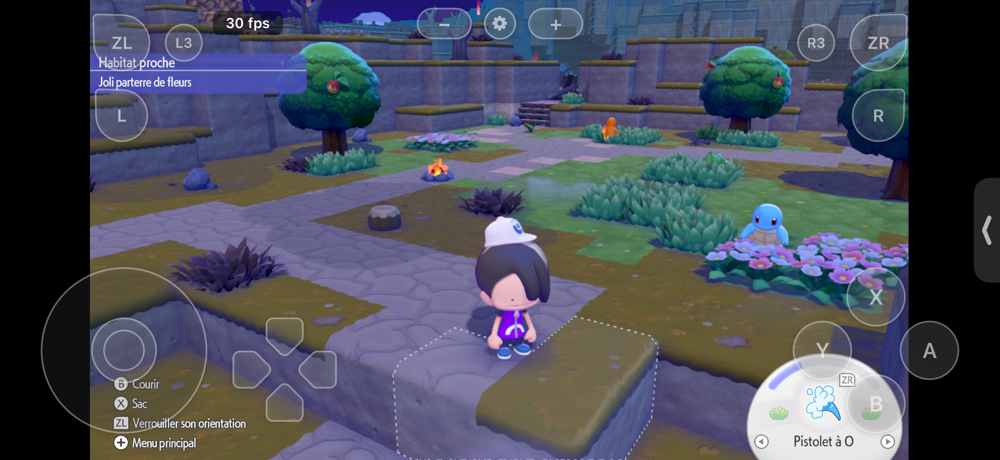
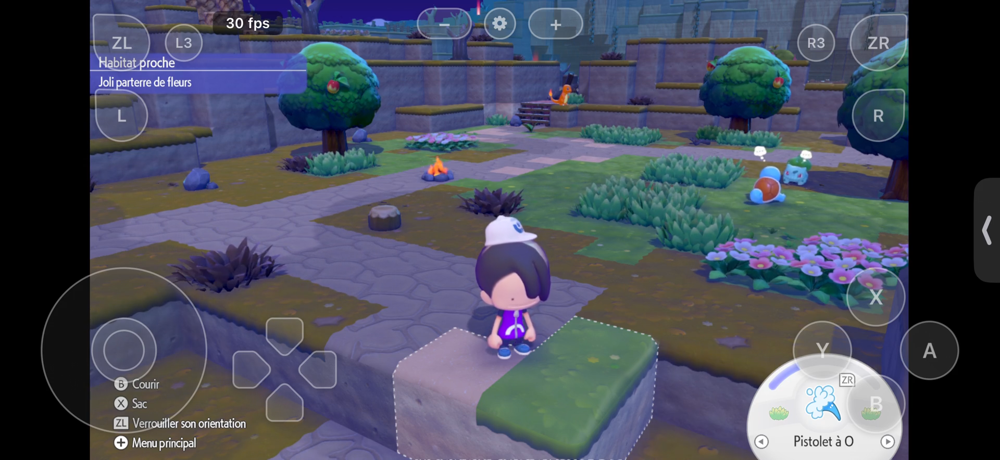

# nxnative iOS — Pokopia

This repository is a source snapshot of the `nxnative` iOS runtime and the Pokémon Pokopia game profile used to build a local iPhone app. It includes the runtime changes for command record validation, RomFS index bounds, and both full and partial iOS shader build workflows.

The app was built and installed on an iPhone Air with an existing partial shader library. The full shader build and extended gameplay validation are separate work; this snapshot is not a prebuilt app.

Read the [technical note on the iPhone bring-up](docs/technical-note.md) for the architecture, source attribution, changes, evidence, and remaining work.

## Captured on iPhone Air

[Watch a 41-second in-game capture (MP4, muted)](media/pokopia-iphone-air-41s-muted.mp4). The character stays in one area while other characters and the scene animate. The on-screen counter displayed 30 fps during this capture; that is an observation, not a performance benchmark. This build uses the partial shader library described below.





## Source and attribution

This snapshot is based on [`seedds/nxnative`](https://github.com/seedds/nxnative) at commit `a3d85ae1259e4cb59b3bc941010e09f8a7159650`, with the local iOS and safety changes described above. The upstream MIT license is preserved in [LICENSE](LICENSE). Third-party notices and licenses remain in `dm/third_party/` and the relevant tool directories.

This project is not affiliated with Nintendo, The Pokémon Company, or the game's publisher.

## Building

You need your own lawful game files and the tools described in the [upstream build instructions](https://github.com/seedds/nxnative#how-to-play). The `dm/games/0400A3A01EE4C000/` profile contains the game-specific tables used by the build tools. Generated game modules, RomFS data, Metal shader libraries, signing material, and the installed app are not included.

The runtime and build scripts are included so the project can be inspected and adapted. A fresh iPhone build requires generating its resources and shaders from your own input files.

### Full shader build

The normal iOS build processes every shader key in the Pokopia profile. Run it once with your own game files; `--no-seen-shaders` states the full-build choice explicitly:

```sh
python3 scripts/build_ipa_from_nsp.py /path/to/your/pokopia-dump --platform ios --no-seen-shaders
```

This is one command, but shaders are compiled progressively with a reusable cache. The first build can take many hours. A partial `--seen-shaders` build is available for quick testing; it omits shaders outside the observed playtest set. The iPhone app described above was installed from that partial path while a full build was in progress.
