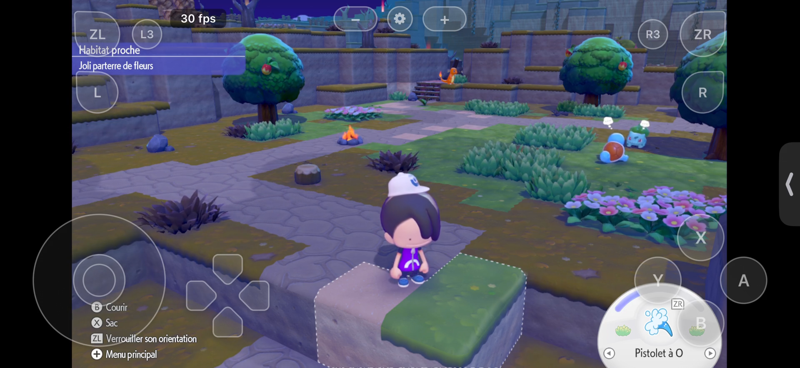

# Pokémon Pokopia on iPhone Air: technical notes on an nxnative bring-up

*Status: 4 November 2026. This describes one local device build, not a general compatibility or performance claim.*

Pokémon Pokopia reached an in-game scene on a physical iPhone Air using an iOS build of [nxnative](https://github.com/seedds/nxnative). The [41-second muted recording](../media/pokopia-iphone-air-41s-muted.mp4) shows the world, the player character, touch controls, and animated characters. The player remains in one area throughout the recording. It demonstrates rendering and continued execution of that scene; it does not establish a playable end-to-end experience.

## Where the work comes from

This repository is a source snapshot based on [`seedds/nxnative` at commit `a3d85ae`](https://github.com/seedds/nxnative/tree/a3d85ae1259e4cb59b3bc941010e09f8a7159650). The upstream project supplies the native execution approach, module rewriting, Horizon host, NVN-to-Metal layer, iOS app shell, shader pipeline, and the existing [Pokopia profile](../dm/games/0400A3A01EE4C000/). Its own acknowledgements credit earlier work by d2r-mobile, Ryujinx, SPIRV-Cross, and others. Their notices are retained in [the third-party directory](../dm/third_party/README.md) and the relevant tool directories. The upstream [MIT license](../LICENSE) is preserved.

The contributions in **this** snapshot are the partial iOS shader build path, three defensive input/command checks, and two audit tools described below. We did not create the generic runtime or the original Pokopia profile. This is an independent project and is not affiliated with Nintendo, The Pokémon Company, or the game's publisher.

## How this build reaches the iPhone

The [build script](../scripts/build_ipa_from_nsp.py) takes game files supplied by the builder, identifies the game profile, extracts resources, rewrites code modules, prepares the shader package, builds Metal shader libraries, and prepares the iOS app. At runtime, the [host](../dm/host/) supplies the expected platform services, while the [NVN layer](../dm/gfx/nvn/) implements graphics over Metal. The shader tools use Ryujinx's translator to produce SPIR-V, then SPIRV-Cross and the Metal compiler to produce iOS libraries. This is a description of the repository's pipeline, not a claim that every graphics feature or game area has been validated on iPhone.

The Pokopia [shader map](../dm/games/0400A3A01EE4C000/shader_map.tsv) lists **131,426 keys**. The installed app uses a *partial* library selected from the profile's observed-shader list. The [iOS packaging change](../dm/ios/tools/build_ipa.sh) explicitly accepts this library when `DM_ALLOW_PARTIAL_SHADERS=1`; the [top-level build script](../scripts/build_ipa_from_nsp.py) also permits `--seen-shaders` on iOS. Missing shaders can leave draws incomplete, so this path is for bring-up. The normal iOS path builds the complete map, progressively and with a reusable cache. A full library build was still in progress when this note was written.

## Changes in this snapshot

| Area | Change | What it establishes |
| --- | --- | --- |
| [iOS shader packaging](../dm/ios/tools/build_ipa.sh) and [build orchestration](../scripts/build_ipa_from_nsp.py) | Allow a partial `--seen-shaders` iOS library; keep it separate from the complete library. | Enables early device bring-up without presenting the partial library as complete. |
| [NVN command records](../dm/gfx/nvn/nvn_obj.h) and [Metal replay](../dm/gfx/nvn/nvn_mtl.m) | Reject invalid record headers and accept only the emitted draw-record layouts. | Catches some malformed command records before replay; command memory still lacks a global segment-length contract. |
| [RomFS image loader](../dm/host/romfs_image.h) | Reject an index larger than 128 MiB before allocating it. | Bounds this specific allocation when opening an image. |
| [NSO/NRO loader](../dm/tools/nso.py) | Default to a 1 GiB input and decoded-image budget, with an explicit API override. | Prevents accidental oversized module loads by default. |
| [Build manifest](../scripts/build_manifest.py) | Record and verify SHA-256 hashes of named inputs and an artifact without writing local paths; optionally verify a signed app. | Supports later build comparisons; it does not prove reproducible output by itself. |
| [PSO audit](../scripts/pso_preheat_audit.py) | Count seed/user overlap and selected log counters without exposing shader keys. | Provides data for a later pipeline preheat experiment; no speedup is claimed. |

The defensive changes had focused Python tests and a C draw-record test under AddressSanitizer and UndefinedBehaviorSanitizer in the isolated development checkout. Those tests do not replace a full iPhone regression run. The public source snapshot has not yet been built end to end from a fresh checkout.

## What the capture does and does not show

The public recording is 41.5 seconds long, encoded at 1920 × 884 and 30 frames per second, with no audio track. **That frame rate describes the recording.** An in-game overlay displayed `30 fps` in inspected frames, but no repeatable frame-time, thermal, GPU, or memory measurement was taken for this publication. The character did not traverse the game world during the clip. Audio, saves, later areas, sustained play, and complete shader coverage have not been established by this capture.

The inherited [Pokopia profile README](../dm/games/0400A3A01EE4C000/README.md) records earlier Mac testing and says that no IPA had been built at that point. This dated note records the subsequent local iPhone result. Its older Mac observations should not be treated as iPhone measurements.

## Next verification steps

1. Finish the complete shader-library build, then rebuild and install a device app from that output.
2. Repeat a defined route on the same save and settings; collect frame times, shader misses, pipeline waits, memory, and thermal state.
3. Build from a fresh checkout of this public snapshot and compare named inputs and artifacts with the [manifest tool](../scripts/build_manifest.py).

The repository contains source and game-specific metadata, **not** game binaries, RomFS data, generated Metal libraries, an IPA, signing material, or private device logs. Builders must supply their own game files. See the [README](../README.md) for the build entry point and the device capture.
